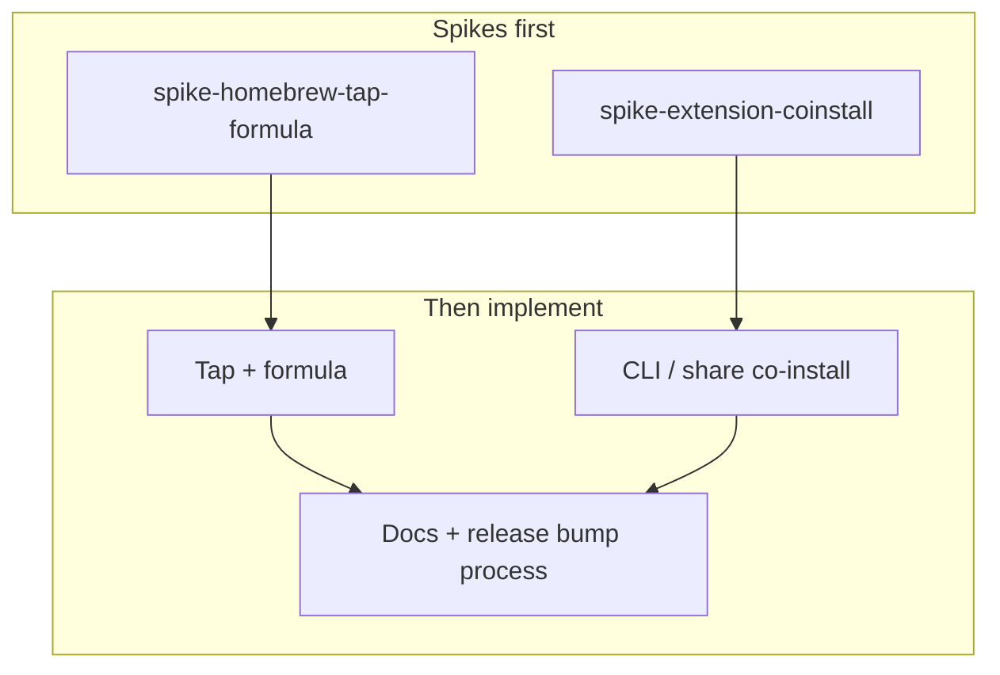

# Distribute TicketMosquito via custom Homebrew tap

- **Task ID:** `homebrew-tap-distribution`
- **Status:** backlog
- **Parent / blocked by:** blocked_by: `spike-homebrew-tap-formula`, `spike-extension-coinstall`

## Problem

macOS users currently install from source or by manually downloading GitHub Release binaries and separately loading browser extensions. That is a poor default for a local CLI+extension product. A **custom Homebrew tap** is the natural distribution channel, but brew alone cannot silently install Chrome/Firefox extensions — so “install the app” and “get a working session capture extension” must be designed together.

## Goal

Ship a maintained Homebrew tap so a user can roughly:

```sh
brew tap <org>/ticketmosquito   # exact tap name TBD by spike
brew install ticketmosquito
ticketmosquito init && ticketmosquito serve
# then a short, documented extension path (CLI-assisted) — TBD by spike
```

…and end with binary on `PATH` plus a clear co-install path for the Ticket Mosquito extension(s).

## Open questions

| # | Topic | Status | Decision |
|---|--------|--------|----------|
| 1 | Tap + formula shape | open | **Spike:** [`spike-homebrew-tap-formula`](spike-homebrew-tap-formula.md) |
| 2 | Extension co-install | open | **Spike:** [`spike-extension-coinstall`](spike-extension-coinstall.md) — architecture change allowed |
| 3 | Platforms in v1 | open | macOS arm64/amd64 required; Linuxbrew optional |
| 4 | Tap automation | open | Manual formula bump on release vs script/CI that opens a PR on the tap repo when `v*` tags publish |
| 5 | Docs home | open | Primary install story becomes brew; keep from-source + raw Release as fallbacks |

## Non-goals

- Replacing GitHub Releases (brew bottles should **consume** them)
- Chrome Web Store / AMO as a hard dependency for the first brew ship (may be recommended follow-ups)
- Docker/deb/rpm/Winget in this task
- Silent extension install that browsers forbid

## Implementation

1. Run both spikes; lock OQs.
2. Create tap repo + formula (and caveats).
3. Implement any agreed CLI / share-layout for extensions (likely `ticketmosquito extension …`).
4. Wire release docs: README Install section, `docs/INSTALL.md`, optional ADR for distribution.
5. Optional: CI job or script to bump formula `version`/`sha256` when tagging.

Depends on tagged releases with stable asset names (already sketched in `release.yml`).

## Done when

- [ ] `brew tap … && brew install ticketmosquito` installs a working binary for supported macOS arch.
- [ ] Documented extension co-install path works in ≤ a few manual browser steps after install (per spike decision).
- [ ] README / INSTALL point at brew as a first-class path; version/sha update process documented.
- [ ] Spikes marked done with locked decisions.

## Notes

### What can be distributed

| Piece | Via brew | Via companion CLI / docs |
|-------|----------|---------------------------|
| Go binary | Formula (primary) | Release assets / from source |
| Extension zip / unpacked tree | `share/` files only | `extension install` materialize + Load unpacked |
| Signed Firefox XPI | `share/` if CI produces it | Open/install from file |
| Config / data dir | Created by `ticketmosquito init` | Not brew’s job |
| MCP endpoint | Runtime (`serve`) | Docs only |

### Architecture (allowed changes)

Spikes may recommend:

- New CLI surface for extension materialization and version checks
- Formula installing extension archives under `share/ticketmosquito/`
- Stable user-owned extension dirs under `~/.ticketmosquito/extensions/`
- Later: cask/`.app`, store listings, Native Messaging — **not** required to start the tap

Avoid baking browser automation. Prefer **assisted** install that respects user gestures.

### Child / related tasks

| Task | Role |
|------|------|
| [`spike-homebrew-tap-formula`](spike-homebrew-tap-formula.md) | Tap, formula/cask, bottles, platforms |
| [`spike-extension-coinstall`](spike-extension-coinstall.md) | How extensions ship with / beside the app |


