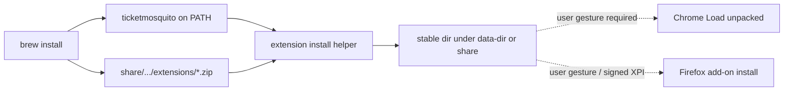

# Spike: Co-install browser extensions with the app

- **Task ID:** `spike-extension-coinstall`
- **Status:** backlog
- **Parent / blocked by:** parent: `homebrew-tap-distribution`

## Problem

Session capture depends on the Ticket Mosquito extension, but browsers **block silent extension install**. Today users manually load unpacked zips or temporary Firefox add-ons — friction that would remain after `brew install ticketmosquito` unless we design an assisted path.

## Goal

Recommend an architecture so that after installing the app (brew or release), getting a working extension is **one clear, repeatable flow** (ideally a CLI subcommand + short docs), without violating Chrome/Firefox security models.

## Open questions

| # | Topic | Status | Decision |
|---|--------|--------|----------|
| 1 | Source of extension bits | open | A) Same GitHub Release zip as CI; B) `go:embed` / data-dir copy from formula `share/`; C) both (brew ships share/, CLI can also download matching version) |
| 2 | Assisted install UX | open | Prefer CLI e.g. `ticketmosquito extension install chrome\|firefox` that: materializes files, prints path, copies to clipboard, optionally opens browser chrome:// / about: pages — user still clicks Load unpacked / Install from file |
| 3 | Firefox persistence | open | Require **signed AMO XPI** for non-temporary install, or accept temporary + docs for now? |
| 4 | Chrome persistence | open | Unpacked from `~/.ticketmosquito/extensions/chrome` (survives restarts if folder stable) vs CRX + private update URL (heavier) |
| 5 | Version skew | open | Extension package version must match binary (`version` / User-Agent / `/health`?) — warn on mismatch? |
| 6 | Architecture change OK? | open | Allow new CLI + formula `share/` layout; defer `.app` / Native Messaging host unless spike proves necessary |

## Non-goals

- Publishing to Chrome Web Store / AMO as the primary path for this spike (may recommend as follow-up)
- Enterprise force-install policies (`ExtensionInstallForcelist`) as the default UX
- Auto-clicking browser UI via accessibility automation

## Implementation

Document browser constraints; prototype options on paper (and optionally a throwaway CLI sketch — no merge required). Output a recommended flow for brew `caveats` + README.

## Done when

- [ ] Chosen primary co-install path (CLI + on-disk layout) with failure modes listed.
- [ ] FireFox vs Chrome persistence called out honestly.
- [ ] List of follow-up implementation tasks (or “fold into parent”) with no open blockers for coding.

## Notes

### Browser reality (constraints)



- **Chrome:** no silent install from Homebrew. Stable **unpacked** directory is the practical path; user enables Developer mode once and Load unpacked pointing at that dir.
- **Firefox:** temporary add-on dies on restart; **signed XPI** is the durable path (needs AMO credentials in CI — already anticipated in release docs).
- Brew may copy zips into `$(brew --prefix)/share/ticketmosquito/`; the **CLI** should copy/unpack into a user-owned path so upgrades don’t break Load unpacked paths mid-session.

### Architecture options (allowed changes)

| Option | Pros | Cons |
|--------|------|------|
| **A. CLI `extension install` + Release/share assets** | Fits current binary; brew-friendly caveats; version-aligned | Still one manual browser step |
| **B. Embed zips in binary** | Single artifact | Larger binary; rebuild to bump extension |
| **C. Minimal macOS `.app` + “Install extension” button** | Friendlier GUI | New packaging surface; cask; more QA |
| **D. Native Messaging host** | Deeper browser integration | Doesn’t install the extension; extra complexity |
| **E. Store listing (CWS/AMO)** | One-click for users | Review lag; separate update trains from brew |

**Suggested leaning for MVP brew:** **A** (CLI + share/Release), with Firefox signed XPI as a tracked follow-up if not ready; document Chrome unpacked as first-class.

### Suggested on-disk layout (sketch)

```
~/.ticketmosquito/extensions/
  chrome/          # unpacked manifest.json + assets (Load unpacked target)
  firefox/         # unpacked or .xpi for Install from File
```

Formula could also place pristine zips at:

```
$(brew --prefix)/share/ticketmosquito/extensions/
  ticketmosquito-chrome.zip
  ticketmosquito-firefox.zip   # or .xpi when signed
```
