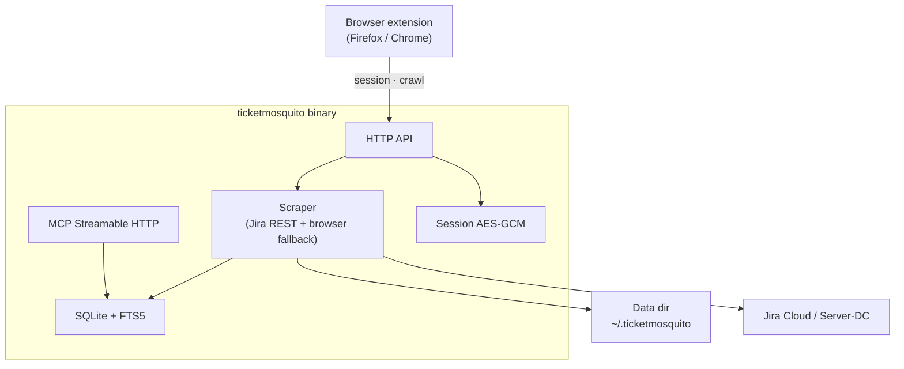
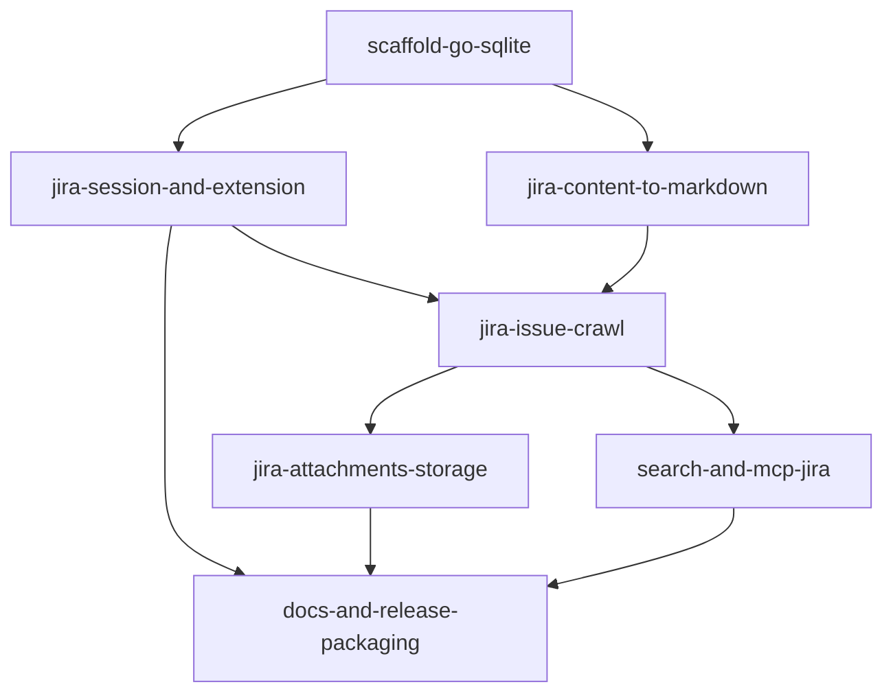

# TicketMosquito MVP epic

- **Task ID:** `ticketmosquito-mvp-epic`
- **Status:** done
- **Parent / blocked by:** — (all epic OQs locked; both spikes done)

## Problem

SpaceMosquito already delivers a local Confluence mirror: browser-session auth, crawl → Markdown + assets on disk, SQLite + FTS5 search, and an MCP server for agents. There is no equivalent for **Jira**. Agents and humans still need live Jira (or brittle exports) to read ticket text, comments, attachments, and fields.

## Goal

Ship **TicketMosquito**: the same product idea and technology shape as SpaceMosquito, but for Atlassian **Jira** — crawl issues (description, comments, attachments, fields), store and index them locally, and expose search + MCP over the local catalog.

Success looks like: capture a Jira session → crawl a project (or issue set) → search/get issues offline via CLI, HTTP API, and MCP.

## Product sketch (reuse SpaceMosquito’s shape)

**Carry over from SpaceMosquito (intent, not a fork plan yet):**

| Concern | SpaceMosquito | TicketMosquito |
|---------|---------------|----------------|
| Unit of crawl | Confluence space → pages | Jira project / JQL → issues |
| Body format | CSF / rendered HTML → Markdown | Issue description (+ comments) → Markdown (ADF/HTML TBD) |
| Extras | Page attachments / diagrams | Issue attachments; comments as first-class content |
| Metadata | Space key, page id, version, ancestors | Project key, issue key/id, status, assignee, and other fields |
| Auth | Extension cookies → encrypted `session.enc` | Same hybrid cookie model, Jira hosts |
| Runtime | Go binary, YAML, SQLite+FTS5, MCP Streamable HTTP, optional go-rod | Same stack and distribution model |
| Agent surface | `confluence_*` MCP tools | `jira_*` (or equivalent) over local catalog |

## Scope (MVP)

**In:**

- Crawl Jira issues: **description**, **comments**, **attachments**, and a useful set of **fields**
- Local catalog + FTS search + get-by-key/id
- Session capture via browser extension; `init` / `serve` / crawl / search CLI
- MCP tools for search and read over the **local** mirror (not live Jira)
- Cloud and Server/DC URL shapes (parity with SpaceMosquito’s dual deployment support), subject to spike findings

**Out (for this epic):**

- Writing back to Jira (create/update issues, post comments)
- Vector / semantic search
- Multi-user / remote API auth for the TicketMosquito HTTP server
- Perfect fidelity for every custom field and every ADF node on day one
- Replacing SpaceMosquito or sharing a monorepo (decision open — see questions)

## Open questions

Do not implement the MVP until these are locked (spikes may propose answers).

| # | Topic | Status | Decision |
|---|--------|--------|----------|
| 1 | **Crawl unit** — project key URL, saved JQL filter, both? Default incremental strategy (updated vs `--force`)? | locked | **Project key** as crawl unit (URL or key). Incremental: skip issues whose remote `updated` is not newer than local; `--force` re-fetches all issues (and assets). No saved-JQL crawl unit in MVP. |
| 2 | **Field set** — which system + custom fields are in MVP vs deferred? Always store raw field JSON? | locked | **Always store raw field JSON.** Promote for catalog/FTS: `key`, `summary` (Jira’s title), `description`. No separate Jira `title` field — `summary` is the title. Other fields stay in raw JSON until promoted later. Comments: store + index (see OQ3). |
| 3 | **Comments model** — separate searchable entities vs concatenated into issue Markdown only? | locked | **A:** store full comments (files/raw); for FTS, append comments into the issue’s searchable Markdown (description + comments). No separate comment search entities in MVP. |
| 4 | **Attachments** — download all binary types vs whitelist; size limits; store under `saved/` like SpaceMosquito? | locked | **Same as SpaceMosquito:** download issue attachments (and inline media referenced from content) into the per-issue `saved/` tree under `assets/` (e.g. `attachments/`, `images/`); no type whitelist / size cap in MVP; skip existing on-disk assets unless `--force`; session cookies for auth; best-effort (log and continue on failure). |
| 5 | **Body conversion** — ADF → Markdown primary, rendered HTML fallback, or both? | locked | **Same dual path as SpaceMosquito:** Markdown is the stored/searchable form. Primary: structured body from the API (ADF/wiki analogue of CSF) → Markdown. Fallback: rendered HTML (browser or API-rendered) → generic HTML→Markdown when the primary path fails or is unavailable. |
| 6 | **Code relationship to SpaceMosquito** — greenfield copy of patterns, selective paste, or shared library later? | locked | **Greenfield repo + selective paste** of small kernels (session blob, paths pattern, asset downloader, HTML→MD, rod launcher, MCP transport glue). No shared published library for MVP. Rewrite domain (schema, crawl, ADF/HTML, MCP tools, extension). Revisit extraction only if a third product appears. See `spike-reuse-from-spacemosquito.md`. |
| 7 | **Naming / ports / data dir** — `ticketmosquito`, default port (avoid clash with `56403`), `~/.ticketmosquito` | locked | Binary/product **`ticketmosquito`**; default MCP/API listen **`127.0.0.1:11043`**; data dir **`~/.ticketmosquito`** (override via `TICKETMOSQUITO_DATA_DIR` / `--data-dir`). |
| 8 | **Extension** — new “Ticket Mosquito” extension vs one Atlassian extension for both products? | locked | **New “Ticket Mosquito” extension** (Firefox + Chrome), separate from SpaceMosquito. Talks to `http://127.0.0.1:11043`. Selective paste of cookie-capture / session UX patterns; Jira host detection and branding. |

## Child / related tasks

| Task | Role |
|------|------|
| [`spike-jira-api-content-model`](spike-jira-api-content-model.md) | APIs, ADF/HTML, comments, attachments, Cloud vs DC — **done** |
| [`spike-reuse-from-spacemosquito`](spike-reuse-from-spacemosquito.md) | Reuse boundary — **done** |
| [`scaffold-go-sqlite`](scaffold-go-sqlite.md) | Binary, data dir, YAML, SQLite |
| [`jira-session-and-extension`](jira-session-and-extension.md) | Session blob + new extension |
| [`jira-content-to-markdown`](jira-content-to-markdown.md) | Description/comments → MD |
| [`jira-issue-crawl`](jira-issue-crawl.md) | Project crawl, incremental, raw fields |
| [`jira-attachments-storage`](jira-attachments-storage.md) | Attachment download |
| [`search-and-mcp-jira`](search-and-mcp-jira.md) | FTS + MCP `jira_*` |
| [`docs-and-release-packaging`](docs-and-release-packaging.md) | Docs, ADRs, release |

## Non-goals

- Live proxying of Jira into MCP without a local crawl
- Confluence crawling (that remains SpaceMosquito)
- Guaranteed legal/ToS advice for scraping customer Jira instances — operators own access rights

## Implementation

High level only — details belong in child tasks after spikes:

1. Lock open questions using spike outputs.
2. Scaffold Go binary + data dir + SQLite + YAML (SpaceMosquito-shaped).
3. Session + extension path for Jira hosts.
4. Discover issues → fetch description/comments/fields/attachments → Markdown + files → index.
5. Search / get / MCP / minimal docs and release packaging.

## Done when

- [x] Spikes complete; open questions in this doc are `locked` (or explicitly deferred with a note).
- [ ] End-to-end: session → crawl → search/get → MCP read for at least one real Jira project (Cloud or Server-DC).
- [ ] Description, comments, attachments, and agreed fields are present in the local catalog for crawled issues.
- [ ] Durable docs exist: README + architecture sketch + ADRs for stack/auth/storage (as needed).
- [x] Child implementation tasks carved (see table); remaining = implement until done.

## Notes

### SpaceMosquito reference

- Local path: `/Users/ruslanbes/projects/SpaceMosquito`
- Key docs: `README.md`, `docs/ARCHITECTURE.md`, `docs/adr/`
- Domain to **replace**: Confluence space/page CSF pipeline → Jira project/issue pipeline
- Shell to **mirror**: Go + rod fallback + encrypted session + extension + SQLite/FTS + MCP Streamable HTTP + on-disk saved artifacts

### Implementation order

See child task table and dependency diagram above. Start with `scaffold-go-sqlite`.