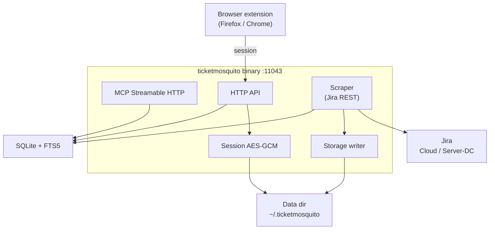

# TicketMosquito Architecture

TicketMosquito is a local Jira issue crawler, indexer, and search engine. It uses
the Jira REST API (Cloud and Server/DC), stores issues in **SQLite + FTS5**, and
exposes an HTTP API plus MCP Streamable HTTP for agents. A browser extension
captures a cookie session for authenticated REST calls.

No Docker / PostgreSQL. See [ADR-002](adr/adr-002-sqlite-only-distribution.md).

## System components



## Entry point

`cmd/ticketmosquito` — CLI + server: `init`, `serve`, `crawl`, `crawl-issue`,
`search`, `get-issue`, `reindex`, `version`.

## Internal packages

| Package | Responsibility |
|---------|----------------|
| `api` | Session + catalog HTTP (`/api/session*`, `/api/search`, `/api/issues/…`) |
| `app` | `serve` wiring — migrate, DB, mux, MCP |
| `cliapp` | CLI commands |
| `config` | YAML config |
| `contentmd` | ADF / wiki / HTML → Markdown for FTS |
| `datastore` | Open + migrate SQLite |
| `jira` | URL helpers, REST client (search, get issue, comments) |
| `mcp` | Streamable HTTP JSON-RPC tools (`jira_*`) |
| `paths` | Data-dir resolvers |
| `scraper` | Project/issue crawl, attachment download orchestration |
| `search` | Public DTOs and excerpt helpers |
| `session` | Encrypted multi-host `session.enc`, flavor detection |
| `storage` | `saved/{project}/{issue}/` writer + attachment downloader |
| `store` / `store/sqlite` | Catalog + FTS5 |

## Data flow

### Session capture

```
Browser (Jira page)
  → extension cookies.getAll()
  → POST /api/session
  → AES-GCM encrypt
  → session.enc under the data directory
```

Flavor (Cloud vs Server/DC) is detected via `/myself` probes and stored on the session.

### Crawl

```
CLI crawl <project>
  → SearchProjectIssues (Cloud /search/jql or DC /search)
  → skip if local jira_updated ≥ remote (unless --force)
  → GetIssue + ListComments
  → contentmd.RenderIssue → Markdown
  → write fields.json, content.md, metadata.json
  → download attachments → assets/attachments/
  → UpsertIssue (FTS triggers keep issues_fts in sync)
```

### Search

```
Query → FTS5 MATCH (AND multi-word, BM25 with summary boost)
     → summary LIKE fallback when FTS returns 0 rows
```

## On-disk layout (data dir)

| Path | Purpose |
|------|---------|
| `config.yaml` | Runtime config + session encryption key |
| `ticketmosquito.db` (or configured path) | SQLite catalog |
| `session.enc` | Encrypted cookies (multi-host) |
| `saved/{PROJECT}/{ISSUE-KEY}/` | Per-issue artifacts |

Per-issue directory (see [ADR-006](adr/adr-006-saved-issue-format.md)):

- `fields.json` — raw Jira `fields` object
- `content.md` — searchable Markdown (description + comments)
- `metadata.json` — key, summary, paths, attachment `local_path`s
- `assets/attachments/` — downloaded binaries

## Database (logical)

**projects** — key, name, url, last_crawled, issues_total

**issues** — jira_id, key, summary, content (Markdown), fields_json, paths, body_format, jira_updated

**issues_fts** — FTS5 over summary + content (Porter tokenizer)

Migrations: `migrations/sqlite/` (also embedded in the binary).

## Security

- Session: AES-GCM, key from `config.yaml`, session file mode restricted
- HTTP/MCP: no multi-user auth in MVP — loopback / local use; MCP rejects non-loopback `Origin` when present
- Tools never proxy live Jira writes

## Related docs

- [ADR index](adr/README.md)
- [Configure MCP](guides/configure-mcp.md)
- [Extension install](guides/extension-install.md)
